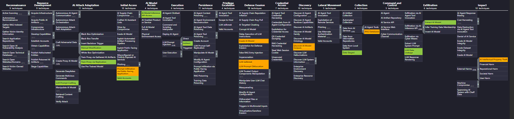

# HireWise AI Security Incident Mapping — MITRE ATLAS Matrix

[](#)
[](https://atlas.mitre.org/)
[](https://atlas.mitre.org/navigator/)
[](#)

> [!NOTE]
> **Academic & Educational Disclaimer**: This repository contains an academic coursework case study completed for educational purposes. **HireWise AI is an entirely fictional entity**, and the 6 incidents analyzed here are simulated, hypothetical scenarios provided as part of an AI security assignment to practice threat modeling and technique mapping using the MITRE ATLAS framework. No actual organization, real individuals, or live enterprise systems are depicted.

---

## 📖 Overview

This assignment evaluates simulated security incidents within a hypothetical recruitment AI system (**HireWise AI**) that utilizes a Large Language Model (LLM) to parse CVs, generate candidate summaries, and recommend applicant rankings.

Observed and suspected Tactics, Techniques, and Procedures (TTPs) across the 6 hypothetical incident scenarios are mapped directly to the **[MITRE ATLAS™ (Adversarial Threat Landscape for Artificial-Intelligence Systems)](https://atlas.mitre.org/)** framework.

---

## 🗺️ Matrix Visualization

The visual matrix below highlights all 16 mapped TTP instances across the AI threat lifecycle.



### Evidence Legend
- 🟩 **Green (`#8ec843`) — Directly Supported by Evidence**: Conclusively verified by the case logs, codebase artifacts, or observed scenario outputs.
- 🟧 **Orange (`#ffa500`) — Implied / Suspected**: Inferred from system architecture or suspected based on observed behavior, but not conclusively proven.

> **Note on Training-Data Poisoning**: In Incident 5, scenario investigators confirmed that underlying training datasets and model weights were **unaltered**. Consequently, training-data poisoning was intentionally excluded in favor of `AML.T0043.003` (*Craft Adversarial Data: Manual Modification*) and `AML.T0051.001` (*Indirect Prompt Injection*).

---

## 📋 Mapped Incidents Summary

| Incident | Description | Mapped ATLAS TTP | Tactic | Evidence Status |
| :--- | :--- | :--- | :--- | :--- |
| **Incident 1**<br>Manipulated CVs | Ingested CVs contained hidden instructions that caused the LLM to ignore instructions and output unrelated text. | **AML.T0051.001** (LLM Prompt Injection: Indirect)<br>**AML.T0065** (LLM Prompt Crafting)<br>**AML.T0093** (Prompt Infiltration via Public-Facing App)<br>**AML.T0068** (LLM Prompt Obfuscation)<br>**AML.T0054** (LLM Jailbreak) | Execution<br>AI Attack Adaptation<br>Initial Access<br>Defense Evasion<br>Defense Evasion | 🟩 Supported<br>🟩 Supported<br>🟧 Implied<br>🟧 Suspected<br>🟧 Suspected |
| **Incident 2**<br>Unauthorized Info Exposure | Assistant summarized candidate and leaked confidential internal notes retrieved from internal document database. | **AML.T0057** (LLM Data Leakage)<br>**AML.T0085.000** (Data from AI Services: RAG Databases) | Exfiltration<br>Collection | 🟩 Supported<br>🟧 Implied |
| **Incident 3**<br>Repeated API Queries | Employee account sent hundreds of queries harvesting rankings, scoring rationales, and output samples to local files. | **AML.T0012** (Valid Accounts)<br>**AML.T0040** (ML Model Access: Production API)<br>**AML.T0127** (Collect AI Model Outputs)<br>**AML.T0024.002** (Extract AI Model)<br>**AML.T0063** (Discover AI Model Outputs) | Initial Access<br>ML Model Access<br>Collection<br>Exfiltration<br>Discovery | 🟩 Supported<br>🟩 Supported<br>🟩 Supported<br>🟩 Supported<br>🟧 Implied |
| **Incident 4**<br>Suspicious External Model | Personal employee repository found containing scraped outputs and script fine-tuning a mimic LLM. | **AML.T0005.001** (Create Proxy AI Model: Replication)<br>**AML.T0024.002** (Extract AI Model) | AI Attack Adaptation<br>Exfiltration | 🟩 Supported<br>🟩 Supported |
| **Incident 5**<br>Input Manipulation | CVs modified before upload with misleading credentials and instructions to influence candidate rankings. | **AML.T0043.003** (Craft Adversarial Data: Manual Modification)<br>**AML.T0051.001** (LLM Prompt Injection: Indirect)<br>**AML.T0093** (Prompt Infiltration via Public-Facing App)<br>**AML.T0015** (Evade AI Model) | AI Attack Adaptation<br>Execution<br>Initial Access<br>Defense Evasion | 🟩 Supported<br>🟩 Supported<br>🟧 Implied<br>🟧 Suspected |
| **Incident 6**<br>Unconfirmed Impact | Cloned model shared with external parties; potential intellectual property theft unconfirmed. | **AML.T0048.004** (AI Intellectual Property Theft) | Impact | 🟧 Suspected |

---

## 📂 Repository Contents

```text
├── HireWise_ATLAS_layer_beta.json     # MITRE ATLAS Navigator JSON layer (Layer v4.5)
├── matrix_beta.png                    # High-resolution visualization exported from Navigator
├── HireWise_Incident_ATLAS_Mapping.pdf # Full 3-page consolidated mapping report & justifications
├── assignment.pdf                     # Original HireWise case study briefing
├── .gitignore                         # Standard project ignore file
└── README.md                          # Project documentation and summary
```

---

## 🚀 How to View Interactive Layer in MITRE ATLAS Navigator

1. Visit the [MITRE ATLAS Navigator Web Application](https://atlas.mitre.org/navigator/).
2. Click **Open Existing Layer** (folder icon) in the top-left toolbar.
3. Select **Upload from local file** and choose `HireWise_ATLAS_layer_beta.json`.
4. The interactive matrix will load:
   - Right-click or hover over colored techniques to inspect detailed case evidence and justifications.
   - Filter or expand subtechniques.
   - Review legend and scoring aggregations.
